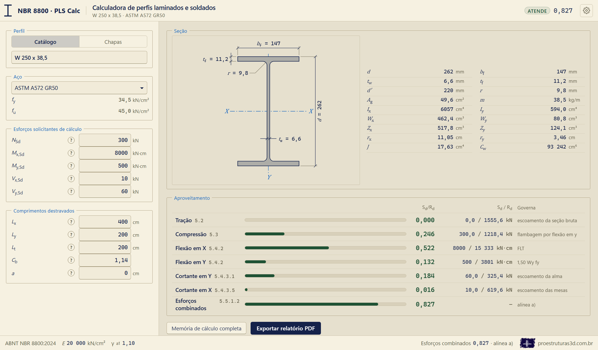
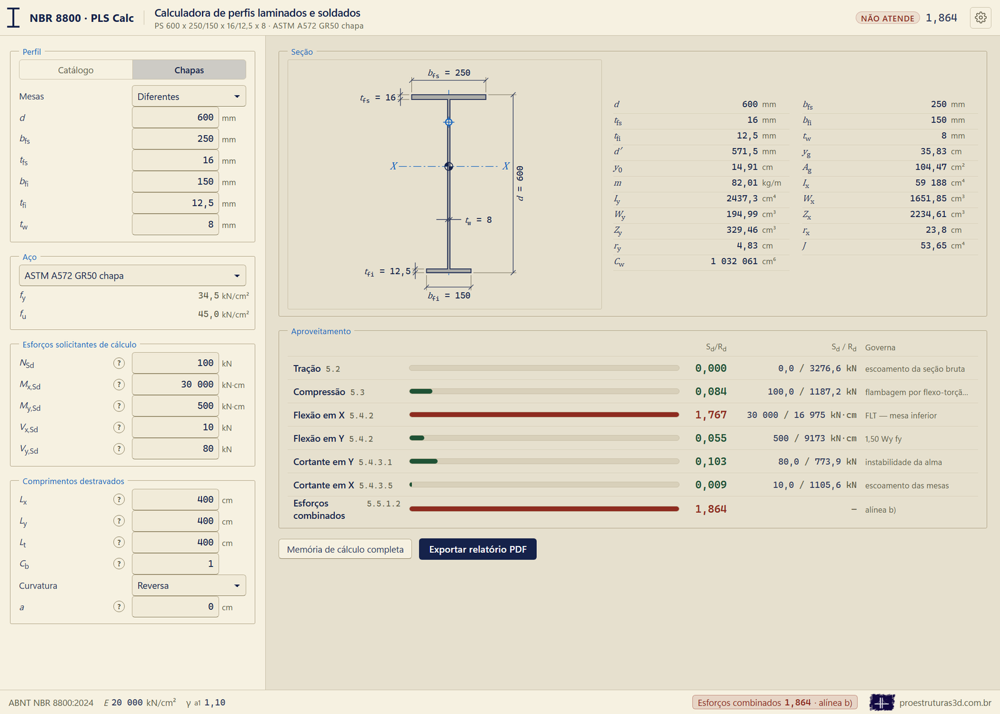
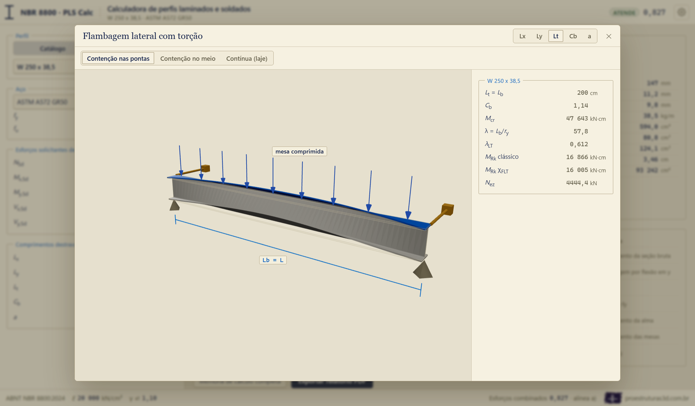
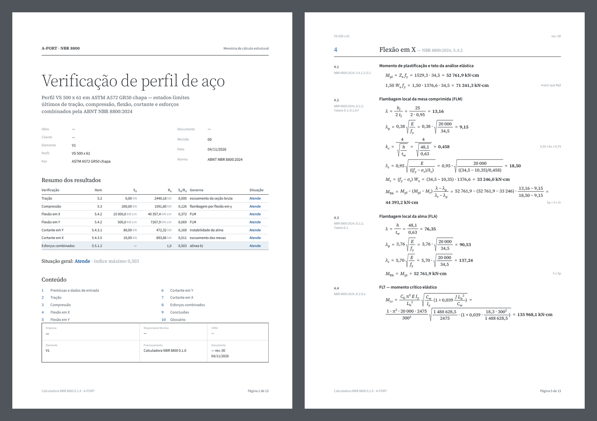
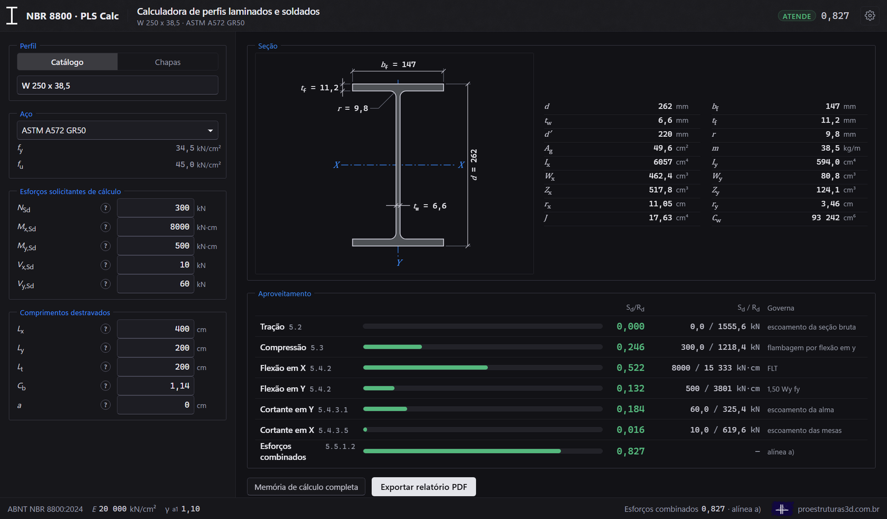
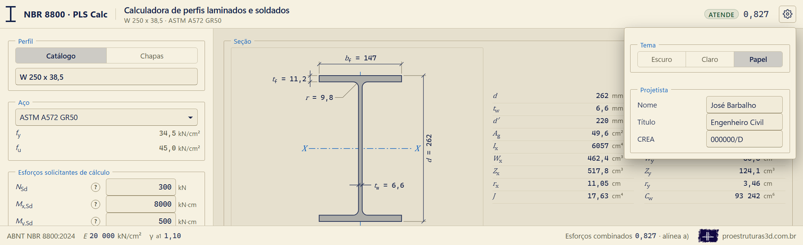

# PLS Calc

**Perfil Laminado e Soldado, pela ABNT NBR 8800:2024.** A PLS Calc verifica uma barra de perfil de aço laminado ou soldado aos estados-limites últimos da NBR 8800:2024 e gera a memória de cálculo completa, com cada fórmula escrita com as letras, com os números e com o resultado, e o item da norma ao lado.

## O que verifica

- **Perfis laminados**, do catálogo: I de abas paralelas (W e HP, Gerdau), I e U padrão americano, cantoneiras de abas iguais e desiguais.
- **Perfis soldados**: as séries CS, CVS e VS da ABNT NBR 5884, ou um perfil de chapas quaisquer, com as duas mesas iguais ou diferentes.
- **Aços** de perfil e de chapa das Tabelas A.1 e A.2 da norma, com a faixa de espessura de cada aço de chapa.
- **Estados-limites**: tração (5.2); compressão com a área efetiva da edição de 2024 (5.3); flexão em X e em Y, com a flambagem local da mesa, a flambagem local da alma e a flambagem lateral com torção (5.4.2 e Anexo D, inclusive a seção monossimétrica); viga soldada de alma esbelta (Anexo E); força cortante nas duas direções (5.4.3); força axial com momentos (5.5.1.2). A cantoneira simples sob momento e força cortante segue o AISC 360-22, com o coeficiente da NBR.

O [manual do usuário](docs/MANUAL.pdf) explica cada campo da tela, como cada verificação é feita, as decisões onde a norma admite mais de uma leitura e como a calculadora foi conferida, com as tabelas de comparação contra exemplos publicados e contas refeitas às cegas.

## Baixar e instalar

### Com o instalador

Baixe o instalador (`PLS Calc Setup 0.1.0.exe`) na [página de versões](https://github.com/josebarbalho25-lang/PLS-Calc/releases/latest) e dê dois cliques. Como o instalador não tem assinatura digital, o Windows pode mostrar o aviso "O Windows protegeu o computador": clique em "Mais informações" e depois em "Executar assim mesmo".

A instalação é por usuário, sem senha de administrador, com atalhos no menu Iniciar e na área de trabalho. O programa abre numa janela própria, sem internet, e o PDF da memória sai pelo próprio programa. O desinstalador, pelo "Adicionar ou remover programas" do Windows, apaga também o que o programa guarda.

### Sem o instalador

É preciso o Windows 10 ou 11, com o Microsoft Edge (que imprime o PDF), e o [Node.js](https://nodejs.org) na versão LTS, 20.19 ou mais recente.

1. Baixe esta pasta pelo botão verde **Code → Download ZIP** e descompacte.
2. Dê dois cliques em **`ABRIR.bat`**. Na primeira vez ele pede o aceite do termo de responsabilidade e instala as bibliotecas, o que precisa de internet e leva alguns minutos.
3. A calculadora abre no navegador, em `http://localhost:5180`. Para fechar, feche a janela preta do `ABRIR.bat`.

## Telas

| | |
| --- | --- |
|  |  |
| Perfil soldado de mesas diferentes, por chapas, com curvatura reversa: as duas mesas verificadas. | A janela do (?) da flambagem lateral com torção, animada, com os números da verificação. |
|  |  |
| A memória de cálculo em PDF: a capa e uma página de contas. | O tema escuro. A engrenagem troca entre escuro, claro e papel. |

A engrenagem guarda também o projetista (nome, título e CREA), que entra no carimbo e na assinatura da memória de cálculo.

## Licença, termo e contato

A PLS Calc é de **José Barbalho** e é distribuída sob a [licença MIT](LICENSE): pode ser usada, copiada, modificada e redistribuída gratuitamente, **desde que o autor seja citado**.

É um software experimental, de apoio à verificação, e a responsabilidade final por qualquer verificação ou projeto feito com ela é do engenheiro responsável. Leia o [termo de responsabilidade](TERMO-DE-RESPONSABILIDADE.md) antes de usar.

Site: [proestruturas3d.com.br](https://proestruturas3d.com.br)

Dúvidas, críticas ou sugestões: contato@proestruturas3d.com.br
