# PLS Calc — Manual do usuário

Perfis de aço laminados e soldados, pela ABNT NBR 8800:2024. Versão 0.1.0, novembro de 2026.

## O que a calculadora verifica e o que fica de fora

A PLS Calc (Perfil Laminado e Soldado, pela NBR 8800:2024) verifica uma barra isolada de perfil laminado ou soldado sob os esforços solicitantes de cálculo que o engenheiro informa: força normal, momentos fletores nos dois eixos e forças cortantes nos dois eixos, todos de uma mesma seção. Ela não faz análise estrutural. Os esforços vêm do modelo do engenheiro (SAP2000, TQS, A-PORT ou outro), já majorados e já com os efeitos de segunda ordem que a análise tiver considerado, e a calculadora devolve as resistências de cálculo, o índice de aproveitamento de cada estado-limite e a memória de cálculo completa.

### Perfis

Quatro famílias de perfis laminados, escolhidas de um catálogo:

- **I de abas paralelas, séries W e HP** (107 bitolas), da Tabela de Bitolas da Gerdau, revisão de novembro de 2018. É o mesmo catálogo do A-PORT.
- **I padrão americano, de abas inclinadas** (38 bitolas, de 3" a 20"), da Tabela A6.2 das Tabelas de Perfis Nacionais da UFPR.
- **U padrão americano, de abas inclinadas** (31 bitolas, de 3" a 15"), da Tabela A6.3 da mesma fonte, pelo catálogo do A-PORT.
- **Cantoneiras de abas iguais** (52 bitolas, catálogo Gerdau e Tabelas A6.4 e A6.5) e **de abas desiguais** (32 bitolas, Tabela A6.6).

E o perfil I soldado, de dois modos:

- **Do catálogo da ABNT NBR 5884**: as séries CS (coluna soldada, 100 bitolas), CVS (coluna e viga soldada, 82 bitolas) e VS (viga soldada, 90 bitolas), transcritas das Tabelas A8.1 a A8.3 da UFPR.
- **Por chapas**: o perfil soldado de chapas quaisquer, que a calculadora chama de PS, com a altura, a espessura da alma e as duas mesas digitadas. As mesas podem ser iguais ou diferentes; com mesas diferentes, a seção tem um eixo de simetria só, o plano da alma.

Nos perfis de abas inclinadas, a espessura da mesa do catálogo é a espessura média. As propriedades que as tabelas brasileiras não publicam (a constante de torção e os módulos plásticos de algumas bitolas, a constante de empenamento e a posição do centro de torção) foram obtidas como descreve o capítulo 7, e a origem de cada uma aparece na memória de cálculo. No perfil soldado, do catálogo ou por chapas, todas as propriedades são calculadas pelas chapas, sem raio de concordância.

### Aços

O perfil laminado leva aço de perfil, e o soldado, aço de chapa, porque a norma dá resistências diferentes para os dois produtos.

- **Aços de perfil**: ASTM A36, A572 graus 42, 50 e 60, A992, A588, A242 nos três grupos de espessura e ABNT MR250, com as resistências das Tabelas A.1 e A.2 da norma.
- **Aços de chapa**: os "chapas e barras" da Tabela A.2 (ASTM A36, A572 graus 42 a 65, A242 e A588) e as chapas grossas da Tabela A.1 (ABNT NBR 6648, graus CG-26 e CG-28; ABNT NBR 5000, graus G-30 a G-45; ABNT NBR 5008, graus CGR 400 e CGR 500). Na chapa, a resistência ao escoamento cai com a espessura, e cada faixa da tabela é um aço da lista; a calculadora confere a chapa mais grossa do perfil contra a faixa escolhida.

ASTM é a American Society for Testing and Materials, que especifica esses aços. O módulo de elasticidade é 20 000 kN/cm² e o módulo de elasticidade transversal, 7 700 kN/cm².

### Estados-limites verificados

| Verificação | Item da norma |
| --- | --- |
| Tração: escoamento da seção bruta | 5.2.2-a |
| Compressão: flambagem por flexão, por torção ou por flexo-torção, com a área efetiva da flambagem local | 5.3 |
| Flexão em torno de X e de Y: flambagem local da mesa (FLM), flambagem local da alma (FLA) e flambagem lateral com torção (FLT) | 5.4.2 e Anexo D |
| Viga soldada de alma esbelta: escoamento da mesa tracionada, FLT e FLM | Anexo E |
| Força cortante nas duas direções | 5.4.3 |
| Força axial com momentos fletores | 5.5.1.2 |
| Cantoneira simples: momento fletor e força cortante | AISC 360-22, F10 e G3 |

### A norma e a edição

A norma é a ABNT NBR 8800:2024, com a Errata 1 de fevereiro de 2025. Nenhuma fórmula vem de outra edição. A única exceção é a cantoneira simples sob momento fletor ou força cortante: a NBR 8800:2024 não traz essas resistências (o item 5.4.1.1 não lista a cantoneira simples, e o 5.4.3.4 trata só da dupla cantoneira em T). Para esse caso, a resistência nominal vem da especificação AISC 360-22, do American Institute of Steel Construction, e é dividida pelo coeficiente de ponderação γa1 da NBR; a memória de cálculo diz isso em cada passo.

### O que fica de fora nesta versão

Ficam de fora: a ruptura da seção líquida efetiva na tração (depende da furação e da ligação, que a seção sozinha não conhece); as ligações, inclusive as soldas entre as chapas do perfil soldado; os estados-limites de serviço; a força cortante nas duas direções simultaneamente (5.5.2.3); os tubos, as seções caixão e a dupla cantoneira em T. Nas cantoneiras de abas desiguais, a flambagem lateral com torção em torno do eixo de maior inércia depende de uma propriedade (βw) que está no Comentário do AISC 360-22; até ele entrar, essa verificação aparece como "Avaliar".

## Como instalar e abrir

A PLS Calc pode ser instalada como um programa do Windows, pelo instalador, ou aberta no navegador a partir do código, pelo GitHub. As contas e a memória de cálculo são as mesmas nos dois caminhos.

### Com o instalador

O instalador, `PLS Calc Setup 0.1.0.exe`, é baixado do site proestruturas3d.com.br ou da página do projeto no GitHub (github.com/josebarbalho25-lang/PLS-Calc). Ele funciona no Windows 10 ou 11 e não precisa de internet depois de baixado.

1. Dê dois cliques no instalador. Como ele não tem assinatura digital, o Windows pode mostrar o aviso "O Windows protegeu o computador"; clique em "Mais informações" e depois em "Executar assim mesmo".
2. A primeira tela mostra o termo de responsabilidade, que precisa ser aceito para seguir.
3. A instalação é por usuário, na pasta do próprio usuário, e não pede senha de administrador. Ela cria atalhos no menu Iniciar e na área de trabalho.

O programa abre numa janela própria, sem servidor e sem navegador. O PDF da memória sai pelo próprio programa, e a caixa "Salvar como" é a do Windows. A desinstalação, pelo "Adicionar ou remover programas" do Windows, apaga também o que o programa guarda (a última entrada, o tema e o projetista). A PLS Calc e a PFF Calc, a calculadora irmã de perfis formados a frio, convivem instaladas na mesma máquina.

### Sem o instalador, pelo GitHub

A calculadora também roda no navegador, servida pela própria máquina. São necessários o Windows 10 ou 11, o Microsoft Edge (que já vem com o Windows e é quem imprime o PDF) e o Node.js na versão LTS, 20.19 ou mais recente, baixado em nodejs.org.

1. Baixe o código do GitHub (github.com/josebarbalho25-lang/PLS-Calc), copie a pasta para o computador e dê dois cliques em `ABRIR.bat`.
2. Na primeira vez, o arquivo mostra o resumo do termo de responsabilidade e pede o aceite. Em seguida instala as bibliotecas, o que precisa de internet e leva alguns minutos.
3. O navegador abre sozinho em `http://localhost:5180`. A janela preta que fica aberta é o servidor da calculadora: enquanto ela estiver aberta, a calculadora funciona. Para encerrar, basta fechá-la.

Nos dois caminhos, a última entrada fica guardada, e a calculadora reabre no ponto em que parou. O tema da tela (escuro, claro ou papel) troca pela engrenagem do canto superior direito e também fica guardado.

### Termo de responsabilidade

A calculadora é uma ferramenta de apoio ao projeto, distribuída sem garantia de qualquer natureza. A responsabilidade pela concepção estrutural, pela obtenção dos esforços, pela escolha das hipóteses e pela verificação final é do engenheiro que assina o projeto. A memória de cálculo mostra cada fórmula com os números substituídos justamente para que o engenheiro confira o resultado antes de assiná-lo. O texto completo está no arquivo `TERMO-DE-RESPONSABILIDADE.md`, na pasta da calculadora, e é o mesmo da tela de aceite do instalador.

## A tela, campo por campo

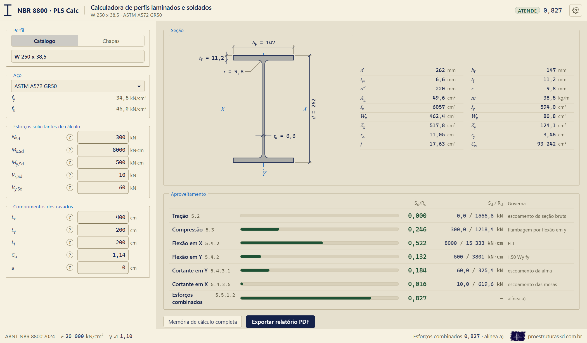

A coluna da esquerda reúne as entradas. A da direita mostra a seção desenhada em escala e cotada, a lista de propriedades geométricas e o quadro de aproveitamento, em que cada linha abre as contas daquela verificação. A barra superior mostra o nome do perfil e do aço, a situação geral e o maior índice de aproveitamento; a barra de estado, embaixo, mostra a verificação que governa e, à direita, o endereço do site do autor, que abre no navegador.

### Configuração (a engrenagem)

A engrenagem do canto superior direito abre um painel pequeno com duas partes:

- **Tema**: escuro, claro ou papel. A troca vale para a tela inteira, inclusive o desenho e as janelas animadas; a memória de cálculo em PDF não muda.
- **Projetista**: nome, título (por exemplo, "Engenheiro Civil") e número do CREA, o Conselho Regional de Engenharia e Agronomia. Os três vão para o carimbo da capa e para o bloco de assinatura da memória de cálculo.

Tudo fica guardado na máquina e grava na hora, sem botão de salvar. O painel fecha com Esc ou com um clique fora dele.

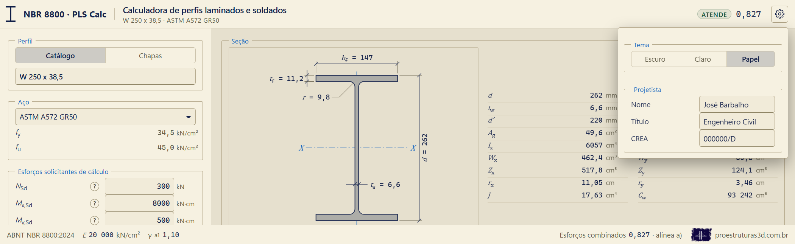

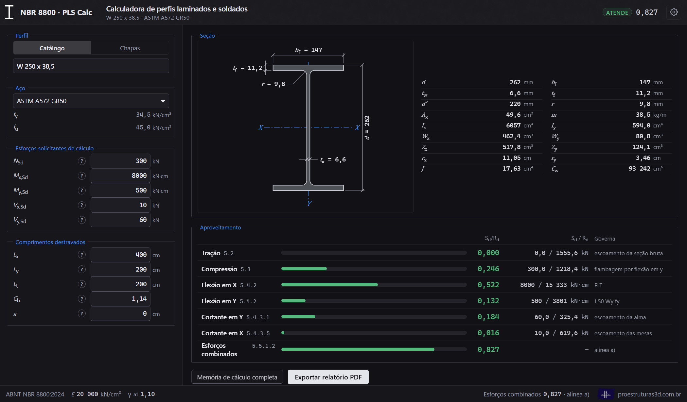

### Perfil

O bloco do perfil tem duas abas: **Catálogo** e **Chapas**.

No catálogo, o campo do perfil é uma busca. Digitar "310" mostra todos os W 310; "38,7" procura pela massa; "hp" mostra os perfis de pilar; "u203" mostra os U de 8"; "l3x3" mostra as cantoneiras de 3"; "vs500" mostra primeiro os VS 500 e depois os CVS 500. A busca ignora maiúsculas, espaços, aspas e traços, e aceita vírgula ou ponto decimal. As setas percorrem a lista, Enter escolhe e Esc fecha sem mudar.

Em chapas, entram a altura total d, a espessura da alma tw e as mesas, todas em milímetros. Com "Mesas: Iguais", basta uma largura bf e uma espessura tf; com "Mesas: Diferentes", entram a mesa superior (bfs, tfs) e a inferior (bfi, tfi). O nome do perfil se monta sozinho, como "PS 600 x 250/150 x 16/12,5 x 8" (altura, larguras, espessuras das mesas e da alma). As chapas digitadas ficam guardadas mesmo quando se volta ao catálogo.

No U, na cantoneira e no I de mesas diferentes, o desenho mostra também o centroide (G) e o centro de torção (CT), porque nessas seções os dois não coincidem e é a distância entre eles que acopla a flexão à torção na compressão. Na cantoneira aparecem ainda os eixos principais de inércia: u, o de maior inércia, e v, o de menor, que é o do raio de giração mínimo.

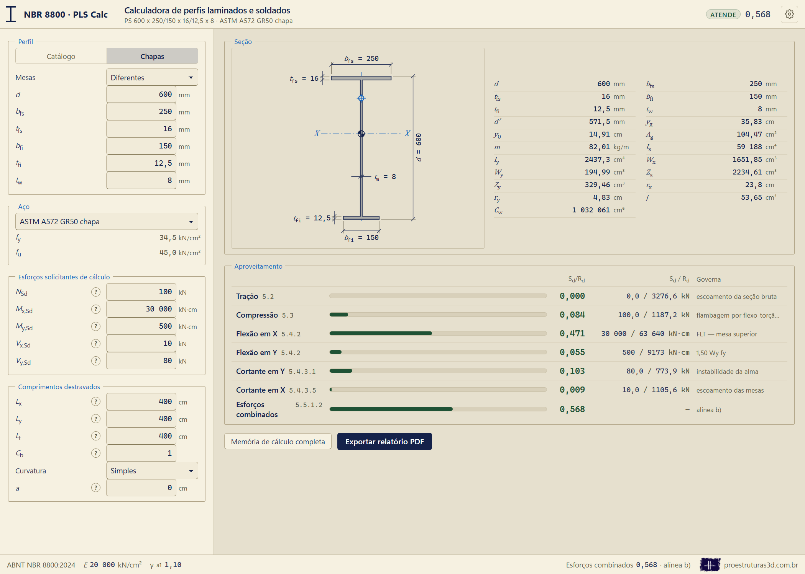

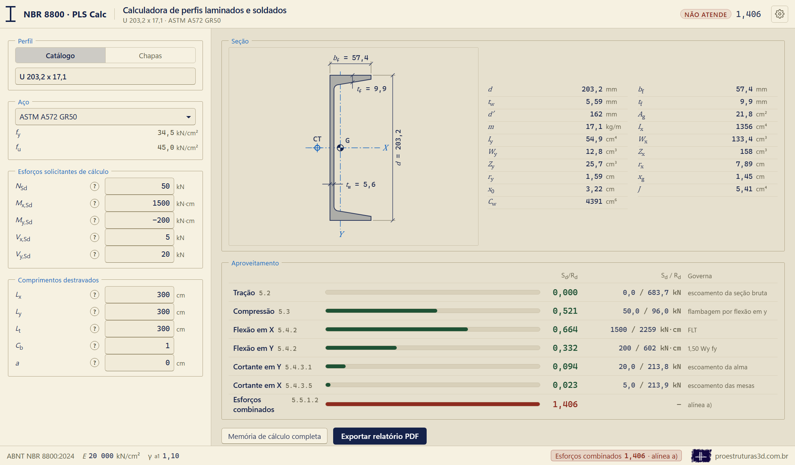

### Aço

A lista de aços mostra, ao lado, a resistência ao escoamento (fy) e a resistência à ruptura (fu), em kN/cm². No perfil laminado ela traz os aços de perfil; no soldado, os de chapa, com as faixas de espessura que não servem para as chapas do perfil apagadas. A calculadora guarda as duas escolhas, a do laminado e a do soldado, e cada família volta com o seu aço.

### Barra (só na cantoneira)

Na cantoneira aparece um bloco a mais, com três escolhas:

- **Comprimida pelo centroide.** A força normal passa pelo centroide, e a flambagem global sai dos itens 5.3.5.2 (abas iguais) ou 5.3.5.3 (abas desiguais), nos eixos principais.
- **Treliça plana, ligada por uma aba** e **treliça espacial, ligada por uma aba.** É o caso do item 5.3.5.4: a excentricidade da ligação entra por um comprimento equivalente. Escolher essa opção é declarar as condições a), b) e c) do item 5.3.5.4.1 (carga aplicada pela mesma aba nas duas extremidades, ligação por solda ou por pelo menos dois parafusos, nenhuma ação transversal intermediária). As condições d), e) e f) a calculadora confere sozinha. Na cantoneira de abas desiguais, escolhe-se também qual aba está ligada.

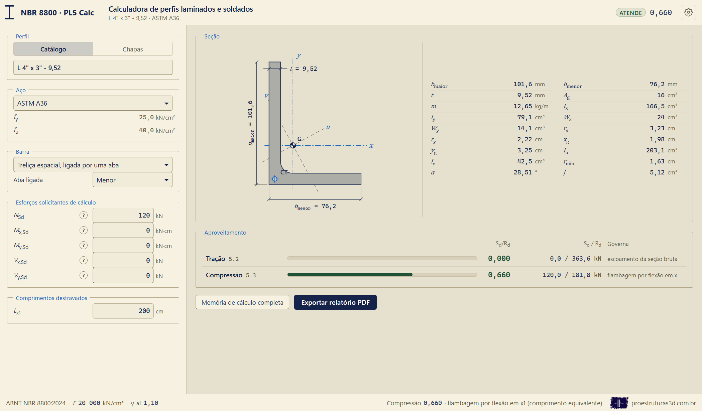

### Esforços solicitantes de cálculo

Os esforços são os de cálculo, já majorados, de uma única seção da barra.

- **NSd**, em kN. **Positivo comprime, negativo traciona**, a mesma convenção do A-PORT.
- **Mx,Sd**, em kN·cm, momento em torno do eixo X, que é o eixo de maior inércia, perpendicular à alma. É o momento do plano da alma.
- **My,Sd**, em kN·cm, momento em torno do eixo Y, o de menor inércia, paralelo à alma. É o momento do plano das mesas.
- **Vx,Sd**, em kN, força cortante na direção X, paralela às mesas.
- **Vy,Sd**, em kN, força cortante na direção Y, paralela à alma.

No perfil I de mesas iguais o sinal dos momentos não muda a verificação. No **I de mesas diferentes**, o sinal de Mx diz qual mesa está comprimida: **Mx positivo comprime a mesa superior**, e negativo, a inferior. No U, o sinal de My importa: My positivo comprime as pontas das mesas, e o estado-limite é a flambagem local da mesa; My negativo comprime a alma, e o estado-limite é a flambagem local da alma (D.2.8-c). Na cantoneira, Mx e My são informados nos eixos das abas (x paralelo à aba menor, deitada; y paralelo à aba maior, de pé) e a calculadora os gira para os eixos principais; Mx positivo comprime o lado de cima, e My positivo comprime o lado direito.

### Comprimentos destravados

Todos os comprimentos são em centímetros.

- **Lx** e **Ly**: comprimentos destravados associados à flambagem por flexão em torno de X e de Y. A edição de 2024 não usa mais o coeficiente K: o comprimento é o trecho entre contenções (5.3.5.1), e o efeito global da estrutura deslocável vem da análise de segunda ordem (4.10). Na cantoneira, Lx e Ly vão para o eixo principal mais próximo; nas de abas iguais, cujos eixos principais ficam a 45°, os dois eixos recebem o maior dos dois comprimentos.
- **Lt**: comprimento destravado à torção. É o Lz da compressão e também o Lb da flambagem lateral com torção.
- **Cb**: fator de modificação para diagrama de momento fletor não uniforme (5.4.2.3), igual ou maior que 1,0, **sem o parâmetro de monossimetria Rm**. A janela do (?) calcula o Cb a partir do diagrama.
- **Curvatura** (só no I de mesas diferentes): **simples**, quando o momento não troca de sinal no trecho destravado, ou **reversa**, quando troca. Na curvatura reversa as duas mesas ficam comprimidas em algum ponto do trecho, e a calculadora verifica as duas contra o mesmo Mx (D.2.8-j), com o Cb multiplicado pelo Rm do item 5.4.2.3.
- **a**: distância entre enrijecedores transversais da alma, usada no cortante (5.4.3.1) e no limite de esbeltez da alma da viga soldada (E.5.3). Não aparece na cantoneira.
- **Lx1** (só na cantoneira de treliça): comprimento da cantoneira entre os pontos de trabalho nos eixos das cordas. Na cantoneira de treliça os outros comprimentos não aparecem.

**O zero de cada campo.** Zero em Lx, Ly ou Lt quer dizer barra travada continuamente naquela direção, e a flambagem correspondente não acontece. Zero em a quer dizer sem enrijecedores. Há uma exceção: na cantoneira, a flambagem por torção não depende do comprimento (a constante de empenamento é desprezada), e por isso o zero em Lt não retira a flexo-torção; ele só retira a flambagem lateral com torção da flexão. O Lx1 da cantoneira de treliça não aceita zero.

Um campo com número que não faz sentido acende em vermelho e volta ao valor anterior: comprimento negativo, Cb menor que 1, ou um número ambíguo como "12.500" (que pode ser doze mil e quinhentos ou doze e meio). "12,5", "12.5" e "1.234,5" são aceitos.

## Como cada verificação é feita

Cada verificação é uma linha do quadro de aproveitamento. A conta inteira, com a fórmula, os números substituídos e o item da norma, abre ao clicar na linha e vai para a memória de cálculo.

### Tração (5.2)

A força de tração resistente de cálculo é a do escoamento da seção bruta, Nt,Rd = Ag·fy/γa1. A ruptura da seção líquida efetiva (5.2.2-b) depende dos furos e da ligação e não é verificada; a memória diz isso. A esbeltez acima de 300 (5.2.8.1) acende "Avaliar", porque o limite é uma recomendação.

Na cantoneira declarada como ligada por uma aba e tracionada, a verificação sai "Avaliar", porque nessa ligação a ruptura da seção líquida quase sempre governa. A memória mostra o produto mínimo Ct·An que a ligação precisa ter: (Ct·An)mín = Nt,Sd·γa2/fu, com γa2 = 1,35.

### Compressão (5.3)

A força axial resistente é Nc,Rd = χ·Aef·fy/γa1 (5.3.2). O fator χ sai do índice de esbeltez reduzido λ0, calculado com a área bruta (5.3.3), e a flambagem local entra pela área efetiva da edição de 2024 (5.3.4), em que a largura efetiva de cada chapa depende do próprio χ. As chapas são as da Tabela 4:

- **Perfil I laminado**: as quatro meias mesas (grupo 4) e a alma (grupo 2).
- **Perfil I soldado**: as meias mesas no **grupo 5**, com (b/t)lim = 0,64·√(E/(fy/kc)) e kc = 4/√(h/tw), entre 0,35 e 0,76 (nota a da Tabela 4). O kc desconta a menor rigidez com que a alma fina do soldado segura a borda da mesa. Com mesas diferentes, cada mesa é uma chapa, com as suas duas metades. A alma fica no grupo 2, com h igual à distância entre as faces internas das mesas.
- **U**: as duas mesas inteiras (grupo 4) e a alma (grupo 2).
- **Cantoneira**: as duas abas (grupo 3).

A largura efetiva nunca é tomada maior que a largura da chapa.

A força axial de flambagem elástica Ne depende da família:

- **Perfil I** (dupla simetria): o menor entre a flambagem por flexão em X, por flexão em Y e por torção (5.3.5.1).
- **Perfil I soldado de mesas diferentes** (simétrico em relação a Y): o menor entre a flambagem por flexão em X e a flexo-torção, que acopla a flexão em Y à torção pela distância y0 entre o centroide e o centro de torção (5.3.5.2). O centro de torção fica entre as mesas, mais perto da mais rígida.
- **U** (simétrico em relação a X): o menor entre a flambagem por flexão em Y e a flexo-torção, que acopla a flexão em X à torção pela distância x0 entre o centroide e o centro de torção (5.3.5.2, com a troca de índices do final do item).
- **Cantoneira de abas iguais** (simétrica em relação ao eixo principal u): o menor entre a flambagem por flexão em v e a flexo-torção em u (5.3.5.2, nos eixos principais).
- **Cantoneira de abas desiguais** (sem simetria): a menor raiz da equação cúbica do 5.3.5.3, nos eixos principais. Quando Lx e Ly são diferentes, a calculadora confere também a flexão em torno do eixo da aba que tem o comprimento maior, acoplada à torção, e fica com o menor dos dois.
- **Cantoneira de treliça ligada por uma aba**: o comprimento equivalente Lx1,eq do 5.3.5.4.2 (treliça plana) ou do 5.3.5.4.3 (treliça espacial), com os pisos para a desigual ligada pela aba menor. Quando a relação entre largura e espessura da aba passa de 0,71√(E/fy), a flexo-torção também é verificada (5.3.5.4.4) e vale o menor. Fora das condições d) ou e), a barra deixa de ser tratada pelo comprimento equivalente: a conta segue pelo centroide e a verificação sai "Avaliar", porque o momento da excentricidade fica por conta do engenheiro (5.3.5.4.5).

A esbeltez acima de 200 (5.3.7.1) acende "Avaliar".

### Flexão (5.4.2 e Anexo D)

O momento resistente de cálculo é o menor entre os estados-limites aplicáveis e o teto de 1,50·W·fy/γa1 do item 5.4.2.2, em que W é o módulo resistente elástico mínimo da seção.

- **Perfil I e U em torno de X**: flambagem local da mesa comprimida (FLM), flambagem local da alma (FLA) e flambagem lateral com torção (FLT), pela Tabela D.1. No U, a relação largura-espessura da mesa é tomada com a largura total da mesa (D.2.8-h), a constante de empenamento é a da fórmula própria do U (D.2.8-a), e vale a premissa do item 5.4.1.2: a carga transversal passa pelo centro de torção, ou a torção está impedida.
- **Perfil I soldado**: a FLM é a de perfil soldado do D.2.8-f, nos dois eixos: λr = 0,95·√(E/((fy − σr)/kc)) e Mcr = 0,90·E·kc·Wc/λ², com a tensão residual σr = 0,30·fy (D.2.8-e). Em mesa esbelta ela dá menos que a fórmula de laminado.
- **Perfil I em torno de Y**: só a flambagem local da mesa; com mesas diferentes, a da mesa de relação largura-espessura maior.
- **U em torno de Y**: pelo sinal do momento. Com as pontas das mesas comprimidas, a flambagem local da mesa; com a alma comprimida, a flambagem local da alma do D.2.8-c e -d, com o módulo resistente efetivo da alma.

**A flambagem lateral com torção é calculada pelos dois caminhos do item D.2.1** (o clássico, com λ entre λp e λr, e o alternativo, com o fator χFLT), **e vale o maior**. A memória mostra os dois. O Cb da edição de 2024 entra só no λr e no momento crítico, e não mais multiplicando o trecho inelástico.

Na **cantoneira simples**, a flexão segue o capítulo F10 do AISC 360-22, sempre nos eixos principais: o escoamento (F10-1), a flambagem lateral com torção em torno do eixo u (F10-2 a F10-4, com Cb limitado a 1,5) e a flambagem local da aba cuja ponta está comprimida (F10-6 a F10-8). Lt igual a zero retira a flambagem lateral com torção. Na cantoneira de abas desiguais, a flambagem lateral com torção em torno de u aparece como "Avaliar" até a fórmula do βw entrar na calculadora.

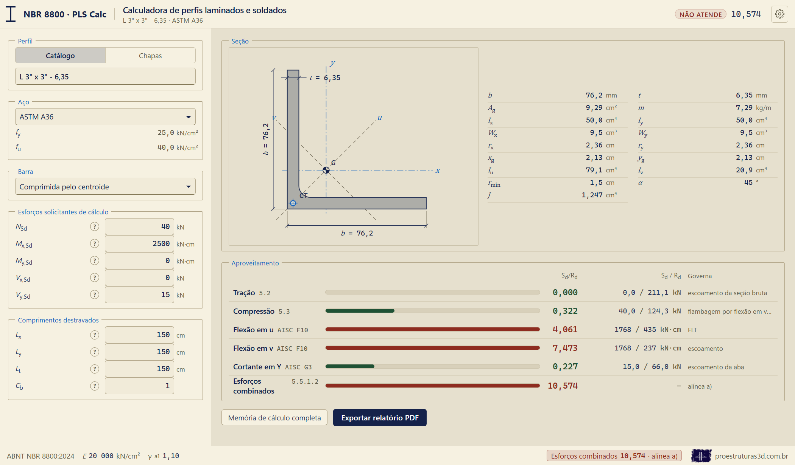

### Perfil soldado de mesas diferentes (Tabela D.1, D.2.8-b, -i e -j)

Com mesas diferentes, quase tudo depende de qual mesa está comprimida, e a calculadora monta a seção vista por ela: os módulos resistentes do lado comprimido (Wc) e do tracionado (Wt); hc, duas vezes a distância do centroide à face interna da mesa comprimida; hp, o mesmo a partir da linha neutra plástica; e a seção T formada pela mesa comprimida e pela parte comprimida da alma, com o raio de giração ryTc e a relação αy = IyTc/Iy. Pela linha da Tabela D.1 das seções I com um eixo de simetria:

- **FLT**: λ = Lb/ryTc, com λr e Mcr do D.2.8-b, que levam os parâmetros β1, β2 e β3 e a constante de empenamento da seção monossimétrica. O momento do início do escoamento é Mr = (fy − σr)·Wc, sem passar de fy·Wt (D.2.8-e). Os dois caminhos do D.2.1 valem também aqui.
- **FLM**: a da mesa comprimida, com Wc.
- **FLA**: λ = hc/tw, com λp = (hc/hp)·√(E/fy)/(0,54·Mpl/Mr − 0,09)², limitado a λr.

Fora dos limites do D.2.8-i (0,1 ≤ αy ≤ 0,9, e a mesa menor com a alma somando mais área que a mesa maior), a conta sai, mas a verificação fica "Avaliar", porque a Tabela D.1 não cobre a seção. Na curvatura simples, o sinal de Mx escolhe a mesa; na reversa, as duas mesas são verificadas contra o mesmo Mx, com o Cb multiplicado por Rm = 0,5 + 2·(Iy,m/Iy)², em que Iy,m é a inércia da mesa menor, e vale a pior das duas (D.2.8-j).

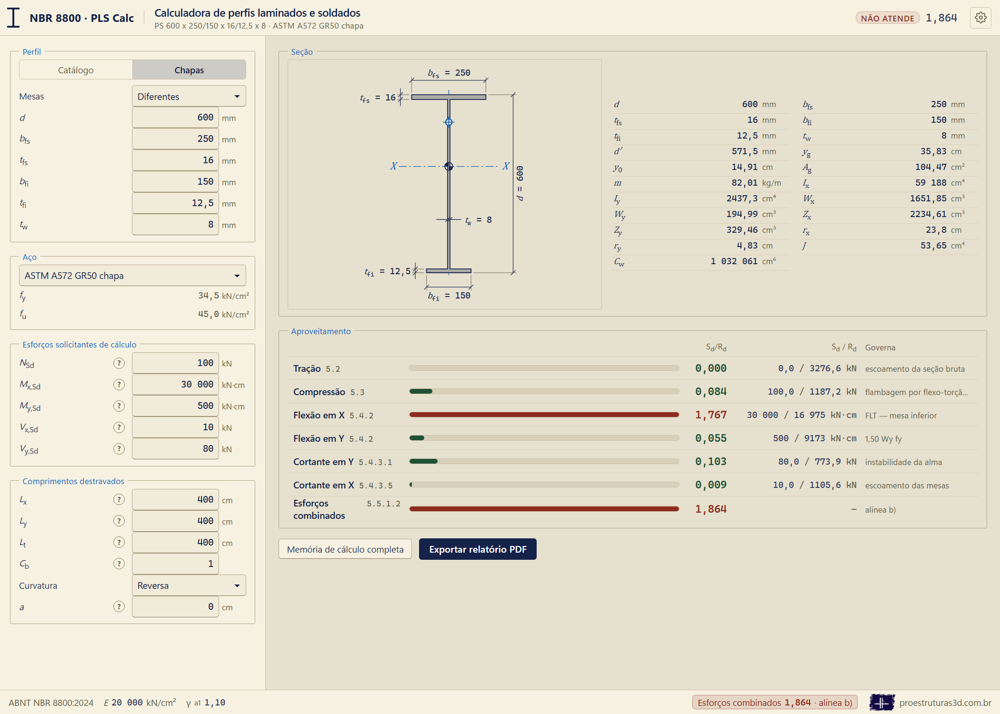

### Viga soldada de alma esbelta (Anexo E)

Quando a esbeltez da alma passa de 5,70·√(E/fy) (λ da flambagem local da alma: h/tw, ou hc/tw com mesas diferentes), a viga é de alma esbelta, e o momento resistente sai do Anexo E: o menor entre o escoamento da mesa tracionada (E.6.1), a flambagem lateral com torção (E.6.2, com λ = Lb/ryc, em que ryc é o raio de giração da mesa comprimida com um terço da altura comprimida da alma) e a flambagem local da mesa comprimida (E.6.3). Os dois últimos levam o fator kpg, que reduz o momento pela flambagem da alma esbelta:

kpg = 1 − ar/(1200 + 300·ar)·(hc/tw − 5,70·√(E/fy)) ≤ 1,0, com ar = hc·tw/Afc ≤ 10.

O item E.5.3 limita a esbeltez da alma: h/tw não pode passar de 260, nem de 11,7·√(E/fy) com enrijecedores transversais a cada a ≤ 1,5·h, nem de 0,42·E/fy sem enrijecedores ou com a/h > 1,5. Acima disso, a norma não admite a viga: a flexão sai "Não atende" e sem número, e a interação também. Esse limite vale para a seção inteira, qualquer que seja o anexo que calcula o momento.

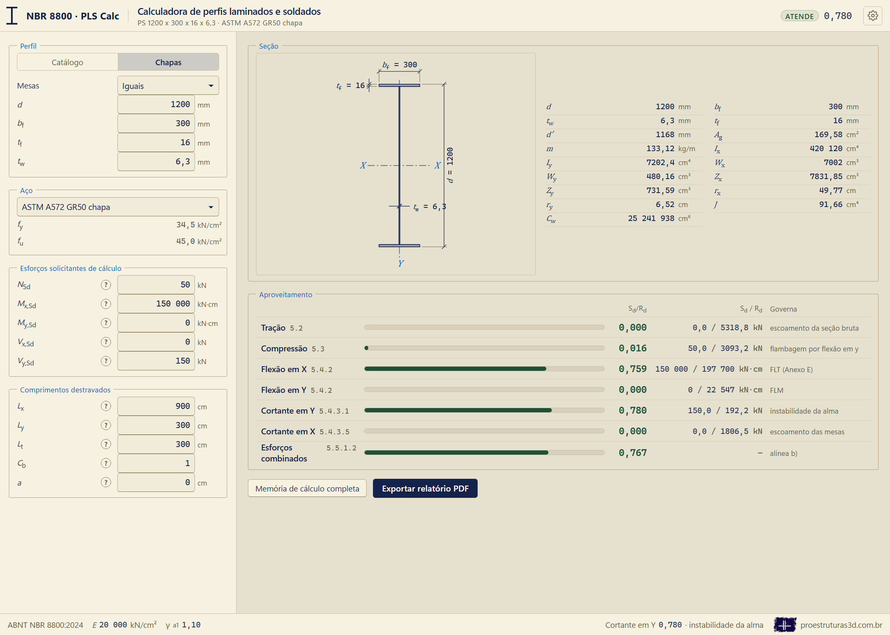

### Força cortante (5.4.3)

- **Na direção Y**, paralela à alma, resiste a alma (5.4.3.1): a área de cisalhamento é d·tw e a esbeltez é h/tw, com h igual à altura plana da alma no laminado e à distância entre as faces internas das mesas no soldado. O coeficiente kv vale 5,34 sem enrijecedores ou com a/h maior que 3, e 5 + 5/(a/h)² nos demais casos.
- **Na direção X**, paralela às mesas, resistem as duas mesas (5.4.3.5), com kv = 1,2: a esbeltez usa metade da largura da mesa no perfil I e a largura total no U. Com mesas diferentes, a área é a soma das duas mesas, e a esbeltez, a da mesa de relação largura-espessura maior.
- **Na cantoneira**, resiste a aba paralela à força (AISC 360-22, G3), com kv = 1,2.

O coeficiente γa1 entra uma única vez, sobre a força cortante de plastificação.

### Esforços combinados (5.5.1.2)

A interação usa a resistência axial que se aplica (de tração ou de compressão, conforme o sinal de N) e os dois momentos em valor absoluto, pelas alíneas a) e b) do item 5.5.1.2. Na cantoneira, os momentos entram nos eixos principais u e v, porque é assim que o item 5.3.5.4.5 manda tratar a cantoneira com força transversal.

### Decisões onde a norma é omissa ou admite mais de uma leitura

- **A força cortante leva o γa1 uma única vez, e a flexão em Y respeita o teto de 1,50·W·fy** (5.4.2.2), mesmo onde planilhas de uso corrente fazem diferente.
- **Flambagem lateral com torção pelos dois caminhos do D.2.1, valendo o maior**, também na seção monossimétrica.
- **Os comprimentos já são destravados**, sem o coeficiente K, como no texto de 2024.
- **A largura efetiva nunca passa da largura da chapa.** Logo acima do limite, as constantes arredondadas da Tabela 5 dariam uma largura efetiva até 0,16 % maior que a chapa.
- **No item 5.3.5.4.3, alínea b)**, vale a Errata 1: "maior que 75", e não "menor ou igual a 75", como saiu impresso.
- **Cantoneira**: eixos principais pelo raio de giração mínimo publicado; centro de torção no encontro das linhas médias das abas; constante de empenamento desprezada; flexo-torção sempre presente; momento e cortante pelo AISC 360-22, divididos pelo γa1 da NBR.
- **Propriedades estimadas**: a constante de torção e os módulos plásticos que nenhuma tabela publica foram estimados a partir do perfil americano mais parecido, como descreve o capítulo 7.
- **Perfil soldado**: a constante de torção é J = Σ b·t³/3, com as mesas inteiras e a alma entre as faces internas das mesas, sem a correção das pontas livres das mesas. É a convenção das tabelas da NBR 5884 (diferença média de −0,01 % nos 272 perfis) e do exemplo do manual "Uso Fácil"; com a correção, o J sairia 3,4 % menor. Na mesa de soldado, b é a metade da largura da mesa (D.2.8-h e figura do grupo 5).
- **O Cb de entrada é sem o Rm**: na curvatura reversa do perfil de mesas diferentes, a calculadora multiplica pelo Rm e mostra a conta. Um Cb digitado já com o Rm teria o Rm aplicado duas vezes.
- **Viga de alma esbelta**: o Anexo E é escolhido pela esbeltez da flambagem local da alma da Tabela D.1 (hc/tw); o limite de h/tw do E.5.3 vale para a seção inteira; a tensão residual do Anexo E é a mesma 0,30·fy do D.2.8-e; e, sem enrijecedores, a/h é tomado como infinito. Na fronteira entre os anexos, o momento resistente cai alguns por cento, porque o Anexo E não usa a constante de torção na flambagem lateral com torção; a queda é da própria norma.

### O que quer dizer "Avaliar"

"Atende" e "Não atende" saem da razão entre o solicitante e o resistente. "Avaliar" quer dizer que a conta precisa do olho do engenheiro: um limite que é recomendação (a esbeltez), uma condição que a calculadora não pode conferir (a ligação por uma aba sob tração), uma seção fora dos limites de aplicação da norma (o D.2.8-i) ou uma resistência que ela ainda não calcula. O aviso que explica o motivo aparece na própria verificação e na memória.

## As janelas do (?)

Cada esforço e cada comprimento tem um botão (?) que abre uma janela animada, com os números da verificação aberta ao lado. As abas no alto da janela trocam entre os esforços (N, Mx, My, Vx, Vy) ou entre os comprimentos (Lx, Ly, Lt, Cb, a).

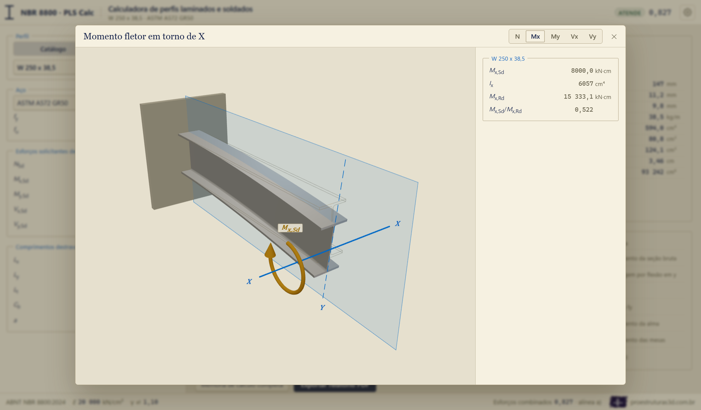

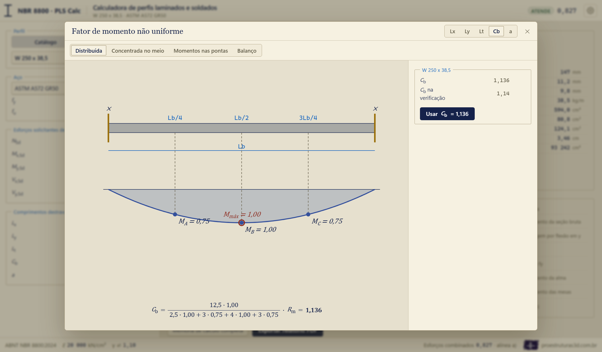

- **Esforços (N, Mx, My, Vx, Vy).** Um pedaço do perfil em balanço, com a face do corte na ponta, os eixos X e Y desenhados no corte e a seta do esforço animada. Mx e Vy agem no plano da alma; My e Vx, no plano das mesas.
- **Lx e Ly.** O pilar flambando em torno do eixo correspondente, sem contenção ou com uma contenção no meio, para mostrar o que é o comprimento destravado.
- **Lt.** A viga em flambagem lateral com torção, com contenção nas pontas, contenção no meio ou contenção contínua (laje), e os números da flambagem lateral com torção pelos dois caminhos. No perfil de mesas diferentes, acende a mesa que a calculadora verificou como comprimida, e o Cb mostrado é o usado na conta, já com o Rm na curvatura reversa; na viga de alma esbelta, mostra o raio de giração ryc do Anexo E.
- **Cb.** O diagrama de momento do trecho destravado com as seções A, B e C da fórmula, para carga distribuída, carga concentrada no meio, momentos nas extremidades (com a relação ψ entre eles) e balanço. O botão "Usar Cb" leva o valor calculado, sem o Rm, para a entrada. Na curvatura reversa do perfil de mesas diferentes, a janela mostra também o Rm da verificação.
- **a.** A alma com e sem enrijecedores transversais, e os números do cortante na direção Y.

Na cantoneira, a janela de Lx mostra os números dos eixos principais (os comprimentos, as esbeltezes e as forças de flambagem em u e em v) ou, na de treliça, o comprimento equivalente.

## A memória de cálculo e o PDF

O botão "Memória de cálculo completa" abre a memória na tela, e "Exportar relatório PDF" grava o arquivo: no navegador, impresso pelo Edge; no programa instalado, pelo próprio programa. Os campos do carimbo (obra, cliente, elemento, documento, revisão e empresa) ficam guardados na máquina e entram no cabeçalho, na capa e no nome do arquivo. Quem assina não fica no carimbo: o nome, o título e o CREA vêm do projetista da engrenagem, num lugar só para todas as obras, e entram no carimbo da capa e no bloco de assinatura das conclusões. Com o projetista em branco, a memória sai com o espaço em branco para a assinatura à mão.

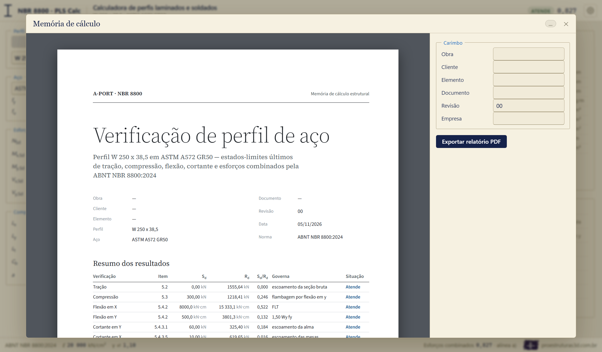

A memória segue o molde do relatório do A-PORT, em folha A4:

1. a capa, com o resumo dos resultados, a situação geral e o carimbo;
2. as premissas: norma e coeficientes, aço, a seção desenhada com a tabela de propriedades e a origem das que não são publicadas, os esforços, os comprimentos e, no perfil de mesas diferentes, a curvatura;
3. um capítulo por verificação, com o item da norma à esquerda e, à direita, cada conta escrita três vezes: a fórmula com as letras, a fórmula com os números e o resultado;
4. as conclusões, com o que não foi verificado e a assinatura;
5. o glossário, só com os símbolos que aquela memória escreve.

A conta e o texto da memória saem da mesma linha de cálculo: não existe uma memória refeita à parte, e o número impresso é o mesmo que a tela mostra.

## Como a calculadora foi conferida

A calculadora foi conferida contra fontes independentes dela, que aqui chamamos de oráculos: exemplos resolvidos publicados, contas refeitas às cegas a partir da norma e uma conta à mão com as fórmulas do AISC 360-22. Cada tabela abaixo traz o perfil, a grandeza, o valor da calculadora, o valor do oráculo, a diferença em porcentagem e, quando ela passa de 0,5 %, a causa. Todas essas comparações estão gravadas como testes automáticos: uma mudança no programa que altere um desses números é recusada.

### Exemplos resolvidos do manual "Uso Fácil"

O exemplo 6.7 do manual "Uso Fácil — ABNT NBR 8800" (revisão 3) verifica uma viga W 410 x 38,8 em ASTM A572 grau 50, com Lb = 300 cm e Cb = 1,14, pela flambagem lateral com torção no caminho clássico. Unidades em kN·cm.

| Perfil | Grandeza | Calculadora | Oráculo | Diferença | Causa |
| --- | --- | --- | --- | --- | --- |
| W 410 x 38,8 | λ (Lb/ry) | 106,01 | 106,01 | 0,00 % | |
| W 410 x 38,8 | λp | 42,38 | 42,38 | 0,00 % | |
| W 410 x 38,8 | λr | 130,28 | 130,83 | −0,42 % | |
| W 410 x 38,8 | Mpl | 25 419,6 | 25 419,6 | 0,00 % | |
| W 410 x 38,8 | Mr | 15 468 | 15 468 | 0,00 % | |
| W 410 x 38,8 | MRd (FLT, caminho clássico) | 16 560 | 16 602 | −0,25 % | |

A diferença no λr é do próprio manual: com os números que ele escreve (β1 = 0,066, Cw = 153 190 cm⁶ e Cb = 1,14), a fórmula do item D.2.8-a dá 130,47, e com o β1 sem arredondar, 130,28, que é o valor da calculadora. A calculadora fica 0,25 % abaixo do manual no momento resistente, do lado seguro.

O exemplo 6.3 do mesmo manual verifica à compressão um perfil soldado CVS 500 x 123 (d = 500 mm, mesas de 350 x 16 mm, alma de 9,5 mm) em aço de fy = 34,5 kN/cm², engastado na base, com 120 cm de comprimento de flambagem nos três modos. É o único exemplo publicado de perfil soldado pela edição de 2024 encontrado, e passa pelo grupo 5 da Tabela 4. As propriedades da calculadora saem das chapas; as do manual, da tabela. Forças em kN.

| Perfil | Grandeza | Calculadora | Oráculo | Diferença | Causa |
| --- | --- | --- | --- | --- | --- |
| CVS 500 x 123 | Ag (cm²) | 156,46 | 156,5 | −0,03 % | |
| CVS 500 x 123 | Ix (cm⁴) | 73 730 | 73 730 | 0,00 % | |
| CVS 500 x 123 | Zx (cm³) | 3 230,6 | 3 231 | −0,01 % | |
| CVS 500 x 123 | J (cm⁴) | 108,95 | 109 | −0,05 % | |
| CVS 500 x 123 | Cw (cm⁶) | 6 697 776 | 6 695 817 | +0,03 % | |
| CVS 500 x 123 | kc | 0,570 | 0,57 | 0,00 % | |
| CVS 500 x 123 | (b/t)lim da mesa, grupo 5 | 11,63 | 11,63 | 0,00 % | |
| CVS 500 x 123 | largura efetiva da alma (mm) | 371,9 | 372 | −0,03 % | |
| CVS 500 x 123 | Aef (cm²) | 147,33 | 147,3 | +0,02 % | |
| CVS 500 x 123 | Nc,Rd | 4 554,75 | 4 554,73 | 0,00 % | |

### Conferência independente às cegas

Seis casos das famílias laminadas foram refeitos por uma conta independente, lida só nas páginas da norma, sem acesso ao programa. A conta independente tirou o raio de giração de √(I/A); a calculadora usa o raio de giração publicado no catálogo. Essa é a causa das pequenas diferenças. Forças em kN e momentos em kN·cm.

| Perfil | Grandeza | Calculadora | Oráculo | Diferença | Causa |
| --- | --- | --- | --- | --- | --- |
| U 203,2 x 17,1, A572 GR50, L = 300 cm | Nc,Rd | 96,00 | 96,00 | 0,00 % | |
| U 203,2 x 17,1 | Mx,Rd (FLT) | 2 258,9 | 2 259 | 0,00 % | |
| U 203,2 x 17,1 | My,Rd (pontas e alma comprimidas) | 602,2 | 602,2 | 0,00 % | |
| U 203,2 x 17,1 | Vy,Rd | 213,75 | 213,8 | −0,02 % | |
| U 203,2 x 17,1 | Vx,Rd | 213,87 | 213,9 | −0,01 % | |
| U 381,0 x 50,4, A572 GR50, Lx = 400, Ly = 100, Lt = 400 cm | Ne (flexo-torção) | 1 915,0 | 1 919 | −0,21 % | |
| U 381,0 x 50,4 | Nc,Rd | 1 240,9 | 1 242 | −0,09 % | |
| U 381,0 x 50,4 | Mx,Rd | 12 332 | 12 330 | +0,02 % | |
| I 203,2 x 30,5, A36, L = 300 cm | Nc,Rd | 290,10 | 290,1 | 0,00 % | |
| I 203,2 x 30,5 | Mx,Rd (FLT) | 5 278,8 | 5 278 | +0,02 % | |
| I 203,2 x 30,5 | My,Rd | 1 090,9 | 1 091 | −0,01 % | |
| L 3" x 3" - 6,35, A36, pelo centroide, L = 150 cm | Nc,Rd | 124,26 | 124,3 | −0,03 % | |
| L 3" x 3" - 6,35, treliça plana, Lx1 = 150 cm | Nc,Rd | 96,25 | 97,80 | −1,58 % | O catálogo dá rx = 2,36 cm, e √(Ix/A) dá 2,32 cm. Com o rx do catálogo, a própria conta independente chega a 96,25. |
| L 4" x 3" - 9,52, A36, pelo centroide, L = 150 cm | Nc,Rd (equação cúbica) | 228,41 | 228,5 | −0,04 % | |
| L 4" x 3" - 9,52, treliça espacial, aba menor, Lx1 = 200 cm | Nc,Rd | 181,82 | 182,0 | −0,10 % | |
| L 4" x 4" - 6,35, A36, pelo centroide, L = 100 cm | Aef | 12,12 | 12,12 | 0,00 % | |
| L 4" x 4" - 6,35 | Nc,Rd | 196,64 | 196,6 | +0,02 % | |

As leituras da norma em que a conta independente e a calculadora concordaram, sem combinar antes, estão no capítulo 4: a troca de índices do item 5.3.5.2 no U, a largura das chapas da Tabela 4, o W mínimo no teto de 5.4.2.2, a flambagem local da alma em torno de Y só no U, o centro de torção da cantoneira no encontro das abas e a Errata 1 no item 5.3.5.4.3.

### Perfil soldado: conferências às cegas

O perfil soldado foi conferido às cegas em duas etapas, cada uma por uma conta independente lida só nas páginas da norma, sem acesso ao programa. A conta independente calculou as propriedades pelas chapas, como a calculadora, e por isso os números coincidem até a última casa. Valores de cálculo, já divididos por γa1; aço de fy = 34,5 kN/cm², salvo o CS 300 x 62, de fy = 25 kN/cm². Forças em kN e momentos em kN·cm.

Na primeira etapa, perfis de mesas iguais: o grupo 5 da compressão e a flambagem local da mesa de soldado.

| Perfil | Grandeza | Calculadora | Oráculo | Diferença | Causa |
| --- | --- | --- | --- | --- | --- |
| VS 500 x 61, Lx = 600, Ly = Lt = 300 cm | Nc,Rd | 1 591,8 | 1 591,8 | 0,00 % | |
| VS 500 x 61 | Mx,Rd (FLM) | 40 357 | 40 357 | 0,00 % | |
| VS 500 x 61 | My,Rd | 7 267,9 | 7 267,9 | 0,00 % | |
| VS 500 x 61 | Vy,Rd | 472,32 | 472,3 | 0,00 % | |
| VS 500 x 61 | Vx,Rd | 893,86 | 893,9 | 0,00 % | |
| VS 500 x 61 | interação 5.5.1.2 | 0,503 | 0,503 | 0,00 % | |
| CS 300 x 62, L = 400 cm | Nc,Rd | 1 542,9 | 1 542,9 | 0,00 % | |
| CS 300 x 62 | Mx,Rd (FLM) | 19 801 | 19 801 | 0,00 % | |
| CS 300 x 62 | My,Rd | 8 114,8 | 8 114,8 | 0,00 % | |
| PS 400 x 300 x 6,3 x 6,3, L = 200 cm, Cb = 1,14 | Nc,Rd | 1 153,1 | 1 153,1 | 0,00 % | |
| PS 400 x 300 x 6,3 x 6,3 | Mx,Rd (FLM elástica) | 13 032 | 13 032 | 0,00 % | |
| PS 400 x 300 x 6,3 x 6,3 | My,Rd | 2 783,6 | 2 783,6 | 0,00 % | |
| PS 400 x 300 x 6,3 x 6,3 | Vy,Rd | 471,98 | 472,0 | 0,00 % | |

Na segunda etapa, mesas diferentes, curvatura reversa e alma esbelta.

| Perfil | Grandeza | Calculadora | Oráculo | Diferença | Causa |
| --- | --- | --- | --- | --- | --- |
| PS 600 x 250/150 x 16/12,5 x 8, L = 400 cm, Cb = 1,0 | Mx,Rd, mesa superior comprimida (FLT) | 63 640 | 63 640 | 0,00 % | |
| PS 600 x 250/150 x 16/12,5 x 8 | Mx,Rd, mesa inferior comprimida (FLT elástica) | 31 342 | 31 342 | 0,00 % | |
| PS 600 x 250/150 x 16/12,5 x 8 | Mx,Rd, curvatura reversa (Rm = 0,5416) | 16 975 | 16 975 | 0,00 % | |
| PS 600 x 250/150 x 16/12,5 x 8 | Nc,Rd (flexo-torção em y) | 1 187,2 | 1 187,2 | 0,00 % | |
| PS 1200 x 300 x 16 x 6,3, Cb = 1,0 | Mx,Rd, Lt = 300 cm (E.6.2) | 197 700 | 197 700 | 0,00 % | |
| PS 1200 x 300 x 16 x 6,3 | Mx,Rd, Lt = 900 cm (E.6.2 elástica) | 88 554 | 88 554 | 0,00 % | |
| PS 1200 x 300 x 16 x 4,75 (h/tw = 245,9) | admissão pelo E.5.3, sem enrijecedores | não atende | não admite | igual | |
| PS 1200 x 300 x 16 x 4,75 | admissão pelo E.5.3, enrijecedores a cada 150 cm | atende | admite | igual | |
| PS 1400 x 400/250 x 19/12,5 x 6,3, Lt = 500 cm | Mx,Rd, mesa superior comprimida (E.6.1) | 219 103 | 219 103 | 0,00 % | |
| PS 1400 x 400/250 x 19/12,5 x 6,3 | Mx,Rd, mesa inferior comprimida (E.6.2) | 125 554 | 125 554 | 0,00 % | |

Nos pontos em que a norma admite duas leituras, a conta independente e a calculadora escolheram o mesmo, sem combinar antes: a metade da largura da mesa no grupo 5; o Cb só no λr e no momento crítico, também no Anexo E; o Rm pela mesa de menor inércia sozinha; cada mesa com as suas próprias grandezas na curvatura reversa; o W mínimo no momento do início do escoamento da flambagem local da alma; a seção T do ryTc com metade de hc de alma e a do ryc com um sexto; a tensão residual de 0,30·fy também no Anexo E; e o limite do E.5.3 tomado com h/tw, e não com hc/tw.

### Cantoneira simples pelo AISC 360-22

A flexão e o cortante da cantoneira simples foram refeitos à mão, fora do programa, com as fórmulas do capítulo F10 e da seção G3 lidas na página do AISC 360-22. Cantoneira L 3" x 3" - 6,35 em ASTM A36, Mx = 5 000 kN·cm, Vy = 20 kN, Lt = 150 cm e Cb = 1,0. Momentos em kN·cm e forças em kN.

| Perfil | Grandeza | Calculadora | Oráculo | Diferença | Causa |
| --- | --- | --- | --- | --- | --- |
| L 3" x 3" - 6,35 | Mu,Rd (FLT em u, F10-2) | 435,32 | 435,32 | 0,00 % | |
| L 3" x 3" - 6,35 | Mv,Rd (escoamento, F10-1) | 236,56 | 236,56 | 0,00 % | |
| L 3" x 3" - 6,35 | Vy,Rd (G3-1) | 65,98 | 65,98 | 0,00 % | |

Esta conta à mão confere a transcrição das fórmulas, mas não substitui um exemplo resolvido publicado pelo AISC, que ainda não foi comparado.

### SAP2000 pelo AISC 360-16

Uma viga em balanço W 200 x 26,6 de uma obra real foi verificada no SAP2000 v26 pelo AISC 360-16 (método dos estados-limites, análise direta), na seção do engaste. A calculadora foi rodada com a mesma entrada do SAP2000: aço com fy = 345 MPa, Lx = Ly = Lt = 63,2 cm e Cb = 1,147. Comparam-se as resistências de cálculo item por item: forças em kN e momentos em kN·cm.

| Perfil | Grandeza | Calculadora | Oráculo | Diferença | Causa |
| --- | --- | --- | --- | --- | --- |
| W 200 x 26,6 | Nc,Rd × φPnc | 1 040,6 | 1 005,4 | +3,5 % | Coeficiente 1/1,10 da NBR contra φ = 0,90 do AISC (+1,0 %) e área bruta da tabela Gerdau, 34,2 cm², contra 33,38 cm² da tabela americana do SAP2000 (+2,5 %). |
| W 200 x 26,6 | Mx,Rd × φMn33 (plastificação) | 8 854,0 | 8 511,5 | +4,0 % | Coeficiente (+1,0 %) e Zx da Gerdau, 282,3 cm³, contra 274,3 cm³ do SAP2000 (+2,9 %). |
| W 200 x 26,6 | My,Rd × φMn22 | 2 333,5 | 2 354,7 | −0,9 % | A NBR limita o momento a 1,50·W·fy/γa1 (5.4.2.2), e esse teto governa; o SAP2000 usou φ·Fy·Zy. |
| W 200 x 26,6 | Vy,Rd × φVn2 | 225,93 | 223,50 | +1,1 % | Coeficiente (+1,0 %); a área de cisalhamento é a mesma, d·tw = 12,01 cm². O SAP2000 usou φv = 0,90, mas a seção G2.1(a) do AISC permite 1,00 neste perfil; com 1,00, o AISC daria 248,3 kN. |
| W 200 x 26,6 | Vx,Rd × φVn3 | 420,47 | 415,95 | +1,1 % | Coeficiente (+1,0 %); a mesma área, 2·bf·tf = 22,34 cm². |

O índice de interação de 1,338 que o SAP2000 mostra não se compara com os índices da calculadora, porque as cargas são outras: o SAP2000 usou as combinações automáticas dele (no engaste, a combinação DSTL8), e a verificação pela NBR usou as combinações da NBR 8681 e da NBR 6120, que dão o momento solicitante de 7 920,6 kN·cm. A ressalva mais importante, porém, é o comprimento destravado. Os 63,2 cm do SAP2000 contam as terças como travamento, e elas estão na mesa de cima, que no engaste do balanço está tracionada; a mesa comprimida é a de baixo, e as terças não a seguram (ver a pergunta sobre as terças no capítulo 8). Com o Lb de 63,2 cm, a calculadora dá índice 0,90 na flexão; com o balanço inteiro (Lt = 360 cm e Cb = 1,0), o momento resistente cai para 6 157 kN·cm, o índice da flexão vai a 1,286 e o da interação, a 1,291.

### Revisões independentes

Duas revisões independentes, uma contra o texto da norma e outra do programa, com um juiz separando defeito real de falso alarme, foram feitas em 1º e em 4 de novembro de 2026, sobre as famílias laminadas. A revisão da norma não achou fórmula errada. Os defeitos reais foram corrigidos, e cada um ganhou um teste que o prende.

O perfil soldado de mesas diferentes e a viga de alma esbelta passaram por outra rodada, com as mesmas duas lentes e um juiz. Os nove achados foram confirmados como defeitos reais, e todos foram corrigidos e presos por teste. Um deles era contra a segurança: o limite de esbeltez da alma do E.5.3 só era conferido quando a conta caía no Anexo E, e uma viga de mesa comprimida pesada, com h/tw acima de 260, podia cair no Anexo D e sair "Atende" sem ser admitida pela norma. O caso é raro, e o limite passou a valer para a seção inteira. Os outros oito eram de tela e de memória: valores negativos de hc e hp quando a linha neutra plástica cai dentro da mesa, a cena em três dimensões que supunha as mesas iguais, um verbete repetido no glossário e textos de rótulo.

### Catálogos

As propriedades dos perfis laminados foram transcritas das tabelas e conferidas por r = √(I/A), W = I/c e massa = 0,785·A. A constante de torção e os módulos plásticos que as tabelas brasileiras não publicam vêm do banco de perfis do AISC quando a peça é a mesma. Quando não é, são estimados a partir do perfil americano mais parecido; refazendo essa estimativa para cada perfil do banco do AISC, deixando o próprio perfil de fora, o erro na constante de torção ficou entre −5 % e +3,5 %. A constante de empenamento sai da fórmula da norma (D.2.8-a), que difere menos de 3 % do valor do AISC. A constante de empenamento e a posição do centro de torção do U foram conferidas por uma segunda conta, por integração da linha média.

Os 272 perfis soldados da NBR 5884 foram transcritos das imagens das Tabelas A8.1 a A8.3 e conferidos contra a conta pelas chapas: a área, as inércias, os módulos resistentes elásticos e o módulo plástico em X batem dentro de 1 %, e a constante de torção dentro de 3 %, porque a tabela a arredonda para o inteiro. A conferência achou cinco erros de impressão no livro (uma massa, dois raios de giração, um módulo resistente e uma relação entre a altura e a espessura da alma), que ficaram anotados ao lado de cada perfil; a calculadora não os usa, porque calcula pelas chapas.

### O que nenhum oráculo cobriu

- Nenhum exemplo resolvido publicado de flexão de perfil soldado, de seção monossimétrica ou de viga de alma esbelta pela edição de 2024 foi encontrado; essas partes foram conferidas pelas contas às cegas das duas etapas. O único exemplo publicado de soldado, o do manual "Uso Fácil", é de compressão.
- As faixas de espessura dos aços de chapa foram transcritas das Tabelas A.1 e A.2 da norma, sem outra fonte para comparar.

- A flambagem lateral com torção da cantoneira de abas desiguais em torno do eixo u, que ainda não é calculada.
- A flambagem local da aba da cantoneira nos trechos não compacto e esbelto (F10-6 a F10-8), e o cortante com Cv2 menor que 1: a conta à mão só passou pelo trecho compacto.
- O modo de conferência da cantoneira de abas desiguais com Lx diferente de Ly, que a norma não escreve (é uma decisão de projeto, registrada no capítulo 4).
- A cantoneira de treliça tracionada, cuja ruptura da seção líquida depende da ligação e não é calculada.
- A flambagem local da alma do U fletido em torno de Y com largura efetiva reduzida, que só aparece em dois perfis em aço A572 grau 60.
- Os perfis com propriedades estimadas (J e Z), cujo erro é o medido acima, e não um valor publicado.
- Nenhum exemplo resolvido publicado de perfil U, de I padrão americano ou de cantoneira pela NBR 8800:2024 foi encontrado; essas famílias foram conferidas pela conta independente às cegas.
- A comparação com o SAP2000 cobre só resistências em que a peça não flamba (a plastificação na flexão em X, porque o Lb de 63,2 cm é curto); a flambagem lateral com torção no trecho inelástico e no elástico só foi conferida contra o exemplo do manual "Uso Fácil" e a conta às cegas.

## Perguntas frequentes

### Como passo os esforços do SAP2000 para a calculadora?

Os eixos locais do SAP2000 têm outros nomes. O momento M3 (em torno do eixo local 3, o "Major") é o Mx daqui, e a força cortante V2 é o Vy: os dois agem no plano da alma. O M2 é o My, e o V3 é o Vx: os dois agem no plano das mesas. O sinal da força normal é o oposto: no SAP2000 a compressão sai negativa (P < 0), e aqui a compressão é positiva. Por isso, numa envoltória, a maior compressão é o **mínimo** de P, e entra aqui com o sinal trocado.

Na envoltória do momento e da cortante, vale o **maior em valor absoluto** entre o máximo e o mínimo. A armadilha mais comum é tomar o máximo positivo: numa viga em balanço, por exemplo, o máximo positivo de M3 era 4 843 kN·cm, mas o que governava era o mínimo, −7 920,6 kN·cm, no engaste. A calculadora usa o valor absoluto dos momentos na interação, mas o sinal do My no U e dos momentos na cantoneira muda o estado-limite, e para esses o sinal tem de ser o da combinação.

Tirar o pior de cada esforço da envoltória (o maior N, o maior Mx, o maior My, cada um de uma combinação diferente) mistura combinações e fica a favor da segurança. Para afinar a verificação, use os esforços simultâneos de uma mesma combinação, uma combinação de cada vez. Os botões (?) dos esforços mostram, em animação, em que plano cada esforço age, e servem para conferir a passagem.

### Como verifico um balanço?

Pela edição de 2024, o comprimento destravado do balanço é medido da contenção até a ponta livre (4.10.6.1), sem o coeficiente K; Lx, Ly e Lt recebem esse comprimento, e o efeito global vem da análise de segunda ordem. O Cb é 1,0 quando o empenamento está impedido no apoio e a ponta é livre (5.4.2.3-b); a janela do Cb tem a forma "Balanço", que dá exatamente 1,0. A forma "momentos nas pontas" com ψ = 0 desenha o mesmo triângulo, mas dá 1,67, porque representa um trecho travado nas duas extremidades e não um balanço. Carga aplicada acima da semialtura, ou outra condição de contenção, pede análise de estabilidade (5.4.2.5).

### As terças travam a viga do pórtico?

Como contenção de translação, as terças travam só a mesa em que estão presas, que normalmente é a de cima. A norma pede a contenção de translação junto da mesa comprimida (4.12.3.2). Quando o momento comprime a mesa de baixo (a sucção do vento, a região dos apoios de uma viga contínua ou o engaste de um balanço), quem flamba é a mesa de baixo, e as terças não a seguram. Nesse caso, o Lt é a distância entre os travamentos da mesa de baixo, e não o espaçamento das terças.

A terça pode, porém, funcionar como **contenção de torção**, que a norma aceita em qualquer altura da seção (4.12.3.5), desde que a ligação tenha o momento resistente Mbr e a rigidez STb do item 4.12.3.6. Essa rigidez inclui a distorção da alma: se a rigidez à distorção da alma, Ssec, for menor que a rigidez pedida, ST, a contenção não é efetiva. Em alma fina, essa conta costuma reprovar, e a saída é um par de enrijecedores sob a ligação da terça ou uma mão-francesa até a mesa de baixo. A calculadora não faz essa conta; ela é do engenheiro.

No balanço, a regra se inverte na ponta: a contenção da extremidade livre tem de estar junto da **mesa tracionada** (4.12.3.2), e essa a terça faz. O que ela não faz é travar a mesa comprimida no engaste.

Programas de verificação que contam as terças como travamento por padrão superestimam a resistência nessas situações. Numa viga em balanço W 200 x 26,6 de 3,60 m, o SAP2000 (Lb = 63,2 cm) e outro programa de dimensionamento (Lb = 121,5 cm, pela opção de travar os pontos onde chegam terças, que vem ligada de fábrica) contaram as terças como travamento. Com o balanço inteiro como comprimento destravado, o índice de aproveitamento da flexão passou de 0,90 para 1,29 (capítulo 7).

### Como verifico uma viga soldada de mesas diferentes nos apoios de uma viga contínua?

Perto dos apoios o momento troca de sinal, e a mesa comprimida troca junto: no vão comprime a de cima, sobre o apoio, a de baixo. Se o trecho destravado contém a troca de sinal, escolha a curvatura reversa: a calculadora verifica as duas mesas contra o maior momento do trecho, em valor absoluto, com o Cb multiplicado pelo Rm. Se o momento não troca de sinal no trecho, use a curvatura simples e entre com o momento com o seu sinal: positivo comprime a mesa superior. O Cb digitado é sempre o do diagrama, sem o Rm.

### Por que o J do perfil soldado difere do de outro programa?

A calculadora usa J = Σ b·t³/3, sem a correção das pontas livres das mesas, que é a convenção das tabelas da NBR 5884. Programas que aplicam a correção, ou que medem a alma até o meio das mesas, dão um J alguns por cento diferente. O J entra na flambagem por torção e na flambagem lateral com torção; nos perfis do catálogo, a diferença para a tabela publicada fica abaixo de 3 %, e a memória mostra a fórmula usada.

### Por que o resultado é diferente da planilha que eu uso?

As causas mais comuns são três: a força cortante dividida duas vezes pelo γa1, o teto de 1,50·W·fy ausente na flexão em Y e a flambagem lateral com torção calculada só pelo caminho alternativo do D.2.1. A calculadora segue a norma nos três casos. A memória mostra cada passo para a comparação.

### Por que a cantoneira com momento usa o AISC?

Porque a NBR 8800:2024 não traz o momento fletor nem a força cortante resistentes da cantoneira simples. O AISC 360-22 é a norma em que a NBR se apoia nesse assunto, e a resistência dele é dividida pelo γa1 = 1,10 da NBR. A memória deixa escrito, em cada passo, que a fórmula é de fora da NBR.

### Por que a cantoneira comprimida dá menos que a conta só com o raio de giração mínimo?

Porque a cantoneira também flamba por flexo-torção: o centro de torção fica no encontro das abas, longe do centroide, e a flexão em torno do eixo de maior inércia se acopla à torção. Nas cantoneiras de abas finas, esse modo governa. A memória mostra os dois modos e diz qual governou.

### O que significa o aviso de entrada recusada na barra de estado?

Que a combinação digitada não tem conta (por exemplo, uma cantoneira de treliça sem o comprimento entre os pontos de trabalho). A tela continua mostrando o último resultado válido até a entrada ser corrigida.

Dúvidas, críticas ou sugestões: encaminhar e-mail para contato@proestruturas3d.com.br
